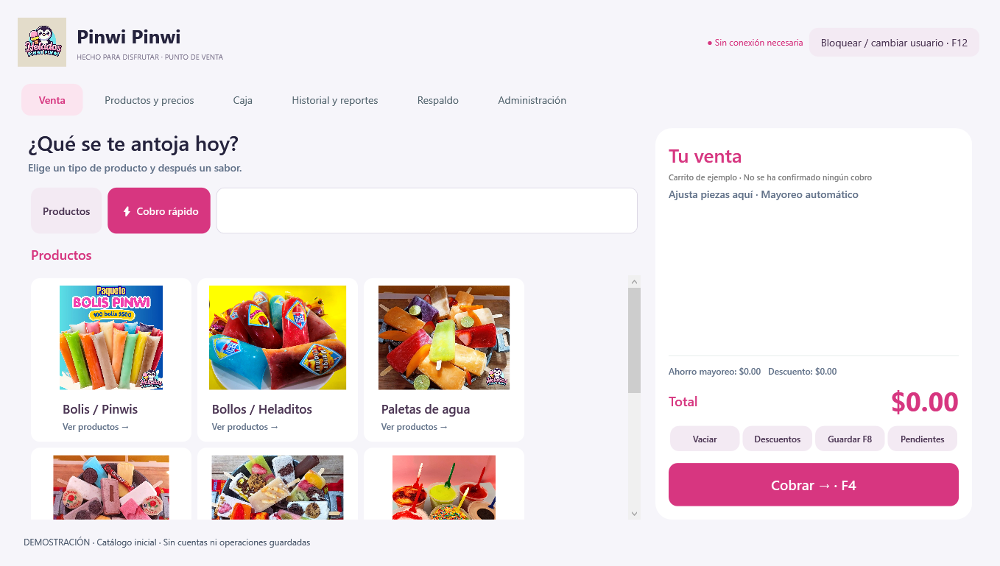
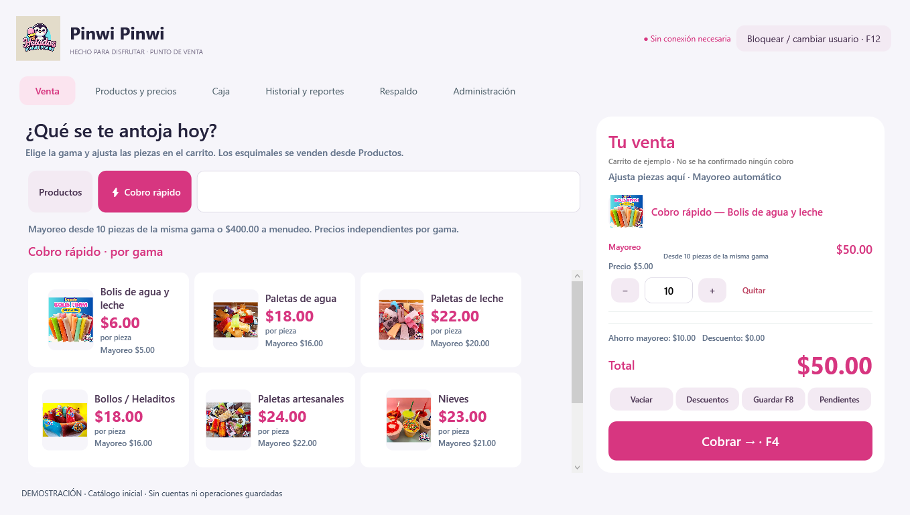

# Helados Pinwi Pinwi — POS para Windows

Un punto de venta para elegir productos, cobrar, llevar la caja y consultar lo vendido en **Helados Pinwi Pinwi**. Funciona en Windows sin necesitar internet para vender y guarda la información en la computadora del negocio.



*Interfaz de la versión 1.1.1.0. Las capturas se generan con el catálogo inicial en un entorno separado, sin cuentas ni operaciones guardadas. No muestran datos del negocio.*

## ¿Cómo se usa?

1. **Entra y abre caja.** Elige tu usuario e indica cuánto efectivo hay para dar cambio. La primera instalación te pide crear al administrador.
2. **Agrega productos.** Selecciona el tipo y el sabor, o usa **Cobro rápido** para cobrar por gama. Ajusta las piezas en el carrito.
3. **Revisa el total.** El POS calcula el mayoreo automáticamente. Los descuentos adicionales requieren autorización.
4. **Cobra.** Elige efectivo, tarjeta externa o mixto. Revisa el cambio y confirma una sola vez. Después puedes ver el ticket o reimprimirlo.
5. **Cierra el día.** Registra gastos y movimientos, cuenta el efectivo y guarda el corte. Consulta reportes y conserva un respaldo.



*Ejemplo sin confirmar: diez bolis suman $50 con los precios iniciales de mayoreo. Las existencias son informativas.*

**[Ver la guía visual completa: pantallas y explicación de cada función](docs/GUIA-VISUAL.md)**

| Necesitas… | Consulta |
| --- | --- |
| Aprender a vender, cobrar y cerrar caja | [Guía visual](docs/GUIA-VISUAL.md) |
| Instalarlo en otra computadora o trasladar datos | [Manual de instalación](MANUAL-INSTALACION.md) |
| Revisar procedimientos y autorizaciones | [Manual de cajero y administrador](MANUAL-OPERACION.md) |
| Informar de un problema | [Soporte técnico](SUPPORT.md) |

El repositorio contiene código y recursos para reconstruir la aplicación; **no incluye el ZIP ni el ejecutable listos para descargar**. El paquete local se entrega por separado. La distribución por Microsoft Store sigue pendiente de aprobación en la última comprobación registrada.

Desarrollado con C# / .NET 10, WPF y SQLite. Repositorio independiente: https://github.com/Reingardo/pos-helados-pinwi-pinwi.

**Soporte técnico del producto:** [página de soporte y canal de contacto](SUPPORT.md).

**Entrega local actual: Operación Segura 1.1.1.0, base v8.** Lee [AGENTS.md](AGENTS.md) y el [estado de validación](ESTADO-OPERACION-V8.md) antes de continuar. La última revisión de Store registrada, el 19 de noviembre de 2026, confirmó el reenvío de 1.1.1.0 a certificación. Por autorización del usuario, comenzará a publicarse automáticamente cuando Microsoft la apruebe; todavía no se confirma disponibilidad pública.

## Abrir o actualizar

Cierra la versión anterior y abre `dist/OperacionSegura-v111/PinwiPOS/Pinwi.Pos.exe`. El ZIP es `dist/PinwiPOS-OperacionSegura-v111.zip`; extrae todo su contenido. `Instalar.ps1` instala por usuario y crea el acceso de escritorio. El paquete es Windows x64 self-contained y no necesita descargar .NET para operar.

La apertura migra a v8 con respaldo previo. Los datos están en `%LOCALAPPDATA%/PinwiPOS`, separados del programa. No abras entregas anteriores sobre la base migrada. No borres ni reviertas datos para resolver errores. El paquete local sigue sin firma; no se cambian protecciones de Windows.

Una instalación limpia crea al primer administrador sin credenciales predeterminadas y sin ventas de prueba. Selecciona el usuario al entrar; las cuentas de cajero se crean desde Administración.

## Funciones disponibles

- 76 productos individuales iniciales, cinco paquetes y siete entradas de cobro rápido por gama, más altas del administrador. Fotos locales y personalizadas incluidas en respaldo.
- Mayoreo desde 10 piezas de la misma gama, mezclando sabores y venta normal/rápida; esquimales por presentación. Umbral global desde $400 a menudeo, sin perderlo al bajar el total ajustado. Umbrales configurables para ventas nuevas.
- Cobro en efectivo, tarjeta externa o mixto, sugerencias y cambio antes de confirmar. Existencias informativas sin bloqueo y sin valores negativos.
- Descuentos generales y por partida, fijos o porcentuales, con autorización. Acumulación con mayoreo configurable y reparto exacto de centavos.
- Carrito recuperable, varios pendientes con referencia por usuario y confirmación transaccional sin duplicación por reintentos.
- Apertura/cierre de caja, gastos de caja/externos, entradas y retiros, cortes conservados y exportaciones diarias.
- Devoluciones parciales y cancelación a precios históricos; conciliación con caja y tarjeta originales, sin borrar la venta.
- Historial por fechas, usuario y método; 100 operaciones por página con totales completos. CSV de todo el periodo y desglose de productos/gamas/paquetes, sin corte en 1,000 ventas. Cajero consulta sus propias operaciones.
- Cuentas de administrador/cajero, bloqueo/cambio de sesión y autorización en la lógica de operaciones sensibles.
- Alta/edición de productos y fotos, disponibilidad y código de barras real de teclado. Configuración de negocio, impresora y papel de 58/80 mm.
- Respaldos consistentes con la API SQLite: hasta 288 recientes, 30 diarios y 12 semanales; destino externo adicional y restauración validada desde interfaz con copia previa.
- Instancia única por base; instalador y publicación no sobrescriben una entrega en ejecución.

Consulta el [manual de cajero y administrador](MANUAL-OPERACION.md) para procedimientos, atajos y condiciones de restauración/devolución. Para llevar el programa a otra computadora, consulta el [manual de instalación y traslado de datos](MANUAL-INSTALACION.md).

## Datos y privacidad

SQLite usa WAL, claves foráneas y `synchronous=FULL`. El dinero se calcula en decimal y se almacena en centavos enteros. Ventas, partidas y movimientos se confirman en una transacción. Las contraseñas utilizan PBKDF2 SHA-256, salt aleatorio y 600,000 iteraciones; no se guardan en borradores.

No subir cuentas, contraseñas, bases, respaldos, ventas, cortes ni gastos de operación o prueba. `dist`, `artifacts`, `.tools` y binarios permanecen ignorados. El catálogo comercial y las imágenes/procedencia sí se versionan. Las pruebas crean datos ficticios temporales aislados.

WhatsApp prepara una nota para envío manual con internet y confirmación manual; no hay envío desatendido ni entrega remota verificada. Resultado de ventas menos gastos no equivale a utilidad contable.

## Compilar y validar

Requiere SDK .NET 10 y NuGet durante el desarrollo. El programa publicado incluye su runtime. En este equipo el SDK por usuario está en `%LOCALAPPDATA%/Microsoft/dotnet/dotnet.exe`.

```powershell
dotnet run --project tests/Pinwi.Tests -c Release
dotnet run --project tests/Pinwi.Tests -c Release -- --render
./scripts/publish.ps1
```

El script genera la entrega y guarda `artifacts/pruebas-operacion.txt`. `--ui` pertenece solo a las pruebas y abre PRUEBA AISLADA con una base temporal, sin usar datos del negocio. GitHub Actions compila, prueba y produce un paquete sin firma; eso no verifica impresoras ni significa aprobación de Store.

Para regenerar las imágenes públicas, usa `dotnet run --project tests/Pinwi.Tests -c Release -- --docs`. Este modo separado crea únicamente vistas con un catálogo temporal, sin cuentas ni operaciones guardadas. Consulta la [procedencia y reproducción de capturas](docs/imagenes/README.md).

## Pendiente

Impresión física de 58/80 mm, lector físico, instalación completa en un segundo Windows limpio sin internet y revisión manual de todas las combinaciones administrativas. Inventario avanzado con costos/recetas/mermas, domicilio y configuración fiscal quedan pendientes. No presentar el alcance completo de AGENTS.md como terminado.
