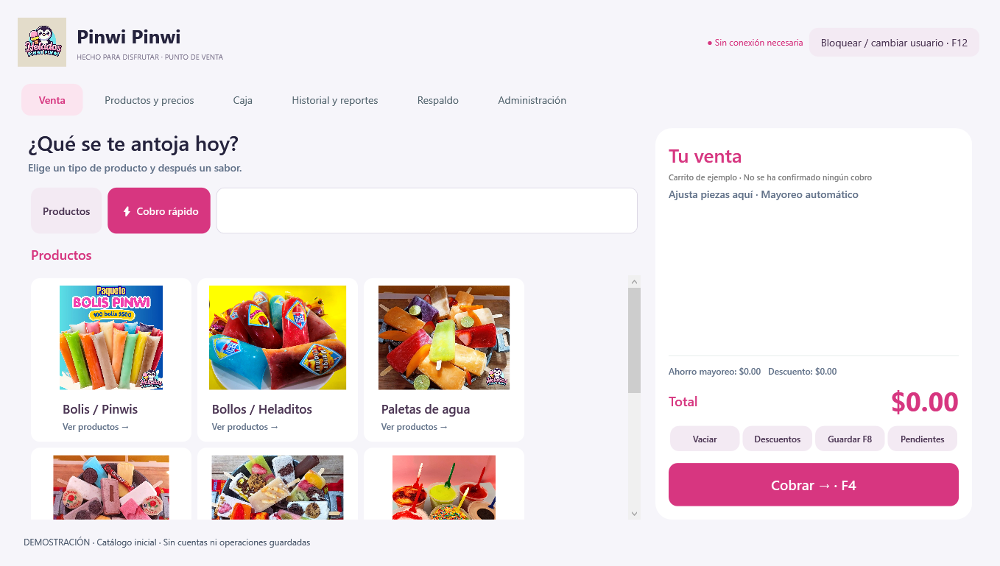
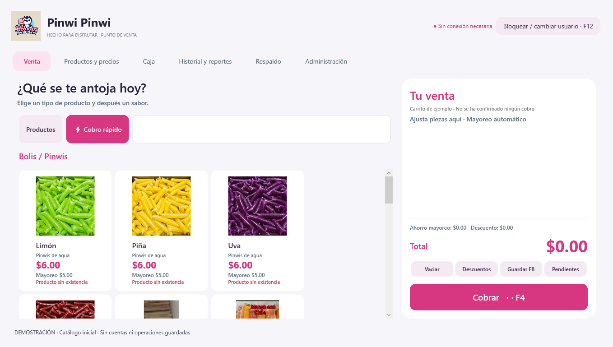
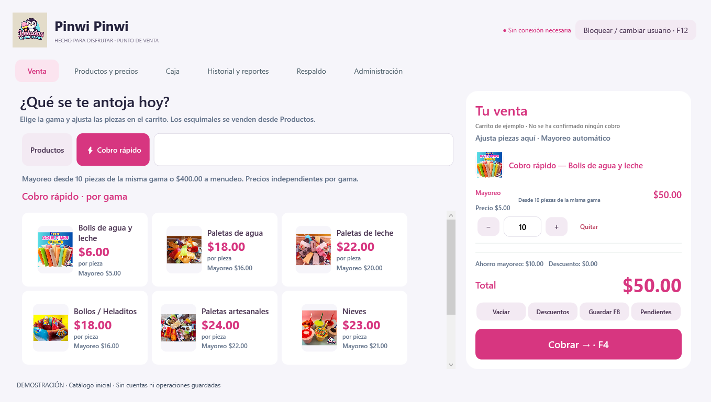
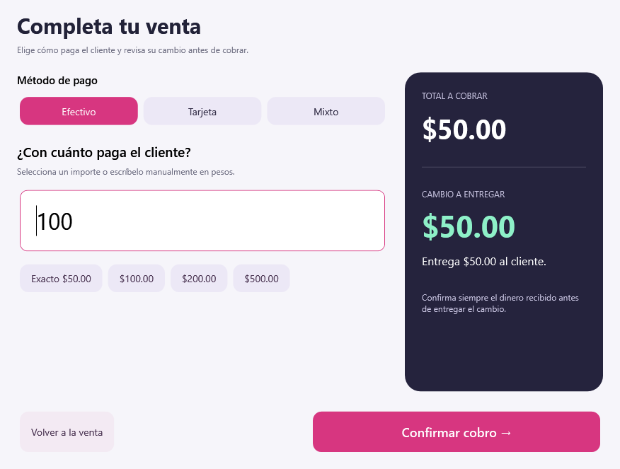
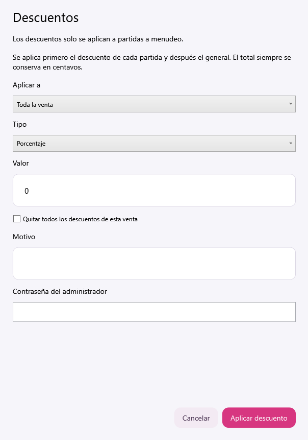
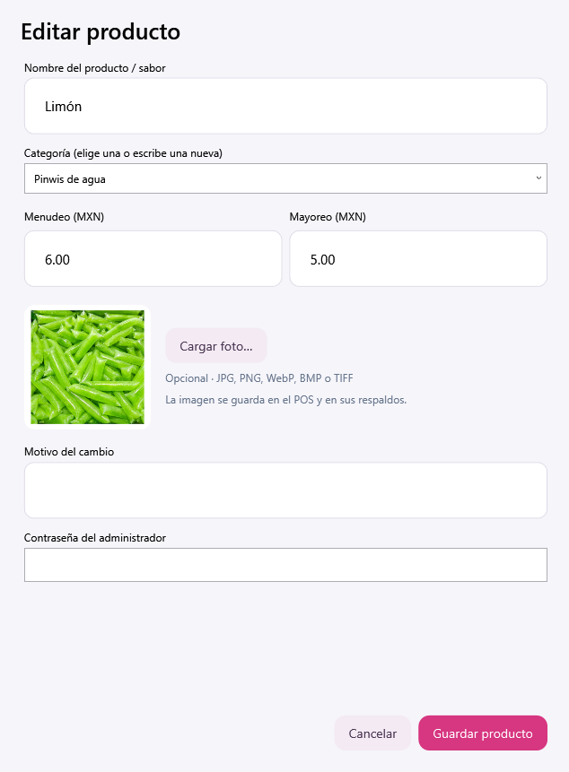
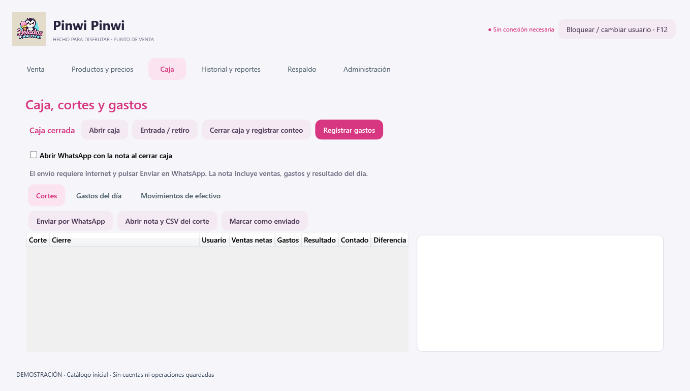
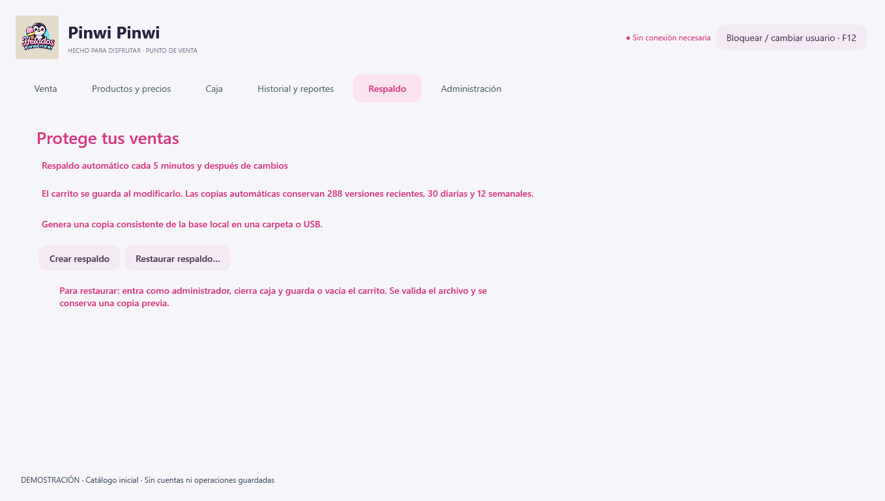

# Así funciona Helados Pinwi Pinwi POS

Esta guía explica la entrega local **1.1.1.0** en palabras sencillas. El programa funciona en **Windows de 64 bits** y permite vender sin internet. Cada computadora conserva sus propios datos; no hay sincronización entre equipos. La edición Store **1.1.2.0** en preparación cambia la ubicación de sus datos y añade una bienvenida para importar un respaldo: consulta el [traslado entre ediciones](../MANUAL-INSTALACION.md#edición-microsoft-store-1120-primer-inicio-y-traslado).

Las imágenes son capturas de las vistas reales del programa, generadas en un entorno separado con el catálogo inicial. No contienen cuentas, contraseñas ni operaciones guardadas. Los carritos e importes mostrados son ejemplos sin confirmar. No son fotografías de un negocio en operación. Las imágenes de productos mantienen la [procedencia registrada en el proyecto](../src/Pinwi.Pos/Assets/image-sources.json); algunas son generadas y no deben interpretarse como fotografías reales de cada sabor.

[Volver a la presentación del proyecto](../README.md) · [Instalar en otra PC](../MANUAL-INSTALACION.md) · [Manual completo](../MANUAL-OPERACION.md) · [Soporte](../SUPPORT.md)

## 1. Entrar y preparar la caja

Al abrir una instalación nueva, crea al primer administrador con tu nombre y una contraseña de al menos ocho caracteres. No hay una contraseña predeterminada. Después, el administrador puede crear cuentas de cajero en **Administración**.

Para comenzar el turno, entra en **Caja → Abrir caja** e indica el dinero que dejas para dar cambio. Ese fondo inicial no se cuenta como venta.

| Usuario | ¿Para qué sirve? |
| --- | --- |
| Administrador | Configura el negocio, administra cuentas y autoriza cambios sensibles. |
| Cajero | Registra la operación diaria y consulta o exporta sus propias operaciones. |

Con **F12** puedes bloquear el POS o cambiar de usuario. No compartas la contraseña del administrador para el uso diario.

## 2. Elegir productos y sabores

En **Venta → Productos**, elige una categoría. Después pulsa el sabor o la presentación para agregarlo al carrito de la derecha. Puedes buscar por nombre o por un código de barras real que hayas asignado al producto.

Usa **+**, **−** o escribe la cantidad y pulsa **Enter**. Puedes quitar una partida o vaciar el carrito antes de cobrar. El total se actualiza al cambiar las cantidades.

El catálogo inicial incluye 76 productos individuales, cinco paquetes y siete opciones de cobro rápido. Puedes añadir más desde administración. Cada unidad de un paquete es **un paquete completo**; no se eligen sus componentes por sabor.

**Si aparece un aviso rojo por existencias, puedes seguir cobrando.** El inventario actual es informativo, no bloquea ventas y no baja de cero. El inventario avanzado con recetas, costos y mermas sigue pendiente.

## 3. Cobro rápido y mayoreo

**Cobro rápido** sirve cuando necesitas registrar la gama —por ejemplo, bolis— sin capturar sabores. Agrega la gama y escribe cuántas piezas llevas. No asigna un sabor ni descuenta existencias de uno en particular. Los esquimales se seleccionan desde **Productos**.

Con la configuración inicial, el mayoreo se aplica automáticamente:

- **Por cantidad:** desde 10 piezas de la misma gama, incluso mezclando sabores y venta normal con rápida. Bolis de agua y leche comparten gama; bollos/heladitos de agua y leche también. Los esquimales se cuentan por presentación.
- **Por consumo:** desde $400 calculados a precio de menudeo, todos los productos pasan a mayoreo. El beneficio se conserva aunque el total ajustado baje de $400.

Ejemplo: cinco pinwis de limón y cinco de piña suman diez de la misma gama. Con los precios iniciales, cada uno pasa de $6 a $5 y el total queda en **$50**. Si bajas la cantidad y tampoco alcanzas el consumo global, se recalcula el precio.

El carrito muestra el precio aplicado y el ahorro. El administrador puede cambiar precios y umbrales para ventas nuevas; las ventas confirmadas conservan sus importes históricos. Los precios de **Cobro rápido** se revisan por separado en **Productos y precios**.

## 4. Cobrar y entregar el ticket

Pulsa **Cobrar** o **F4**. Elige la forma de pago y revisa los importes antes de confirmar:

| Forma de pago | Qué haces |
| --- | --- |
| Efectivo | Escribes cuánto te entrega el cliente. El POS calcula el cambio. |
| Tarjeta | Cobras en una terminal externa y confirmas su autorización en el POS. |
| Mixto | Registras la parte de tarjeta y el efectivo recibido. El cambio sale del efectivo. |

En la imagen, un total de **$50** pagado con **$100** deja **$50 de cambio**. Es una vista de ejemplo: no se ha registrado un pago.

Al confirmar, se guarda la venta y puedes ver el ticket. El POS no procesa tarjetas ni guarda sus números. El ticket es un comprobante de venta; no genera facturas fiscales en línea.

Si la impresora falla, **la venta sigue guardada**. Revisa la impresora y reimprime desde **Historial y reportes**, sin cobrar de nuevo. Se puede configurar papel de 58 u 80 mm; la impresión física aún requiere comprobarse con el equipo real.

## 5. Descuentos y ventas pendientes

En **Descuentos**, elige toda la venta o un producto. Puedes usar porcentaje o un importe fijo en pesos. Indica un motivo y solicita la autorización del administrador. Primero se aplica el mayoreo; después, los descuentos permitidos. Inicialmente no se acumulan descuentos adicionales con mayoreo, salvo que el administrador habilite esa opción.

Si el cliente aún no termina de elegir, pulsa **Guardar F8**, escribe una referencia y después recupérala en **Pendientes** con el carrito actual vacío. Cada usuario tiene sus propios pendientes. Al recuperar se usan los precios vigentes y los descuentos deben autorizarse otra vez al cobrar.

El carrito activo también se guarda automáticamente durante el uso normal. Guardar un pendiente **no confirma una venta**.

## 6. Cambiar productos, precios y fotos

En **Productos y precios**, selecciona un producto y pulsa **Editar producto y foto**. Puedes cambiar nombre, categoría, menudeo, mayoreo y foto. **+ Añadir producto** crea uno nuevo. Los cambios requieren motivo y autorización; editar el precio o la foto no cambia las existencias.

También puedes activar o desactivar productos y asignar códigos de barras que ya existan. Desactivar un producto no borra sus ventas anteriores. Las fotos personalizadas quedan incluidas en el respaldo de la base.

En **Administración → Configuración del negocio** puedes ajustar nombre, contactos, dirección opcional, reglas de mayoreo, acumulación de descuentos, impresora, papel y una carpeta adicional de respaldos. Los cambios se aplican a operaciones nuevas.

## 7. Gastos, entradas, retiros y cierre

La sección **Caja** reúne las operaciones de efectivo:

| Opción | Ejemplo y efecto |
| --- | --- |
| Registrar gastos | Comprar vasos o material. Si pagas de caja, disminuye el efectivo esperado; si pagas por fuera, no. Ambos reducen el resultado de ventas menos gastos. |
| Entrada / retiro | Agregar cambio o retirar dinero para depositarlo. Ajusta el efectivo esperado; no se considera venta ni gasto. Requiere motivo y autorización. |
| Cerrar caja y registrar conteo | Escribe el efectivo que contaste. Revisa lo esperado, lo contado y la diferencia antes de cerrar. |

El efectivo esperado contempla fondo inicial, cobros en efectivo, gastos de caja, entradas, retiros y devoluciones en efectivo. Los cortes anteriores se conservan junto con su resumen y archivos CSV.

**Ventas menos gastos no equivale a utilidad contable.** No incluye un cálculo completo de costos.

WhatsApp es opcional: prepara una nota, pero necesita internet y que tú pulses **Enviar**. El POS no envía reportes por su cuenta ni verifica que el destinatario los haya recibido.

## 8. Consultar ventas, reportes y devoluciones

En **Historial y reportes**, filtra por fechas, usuario y forma de pago. El listado muestra 100 operaciones por página; los totales corresponden al periodo completo. Los CSV de **Exportar operaciones** y **Exportar productos** incluyen todo el filtro, no solo la página visible. Un cajero ve sus propias operaciones.

Para revisar una venta, selecciónala y usa **Ver ticket / reimprimir**. Para devolver productos o cancelar una venta, pulsa **Devolución / cancelación**, indica cantidades, motivo y autorización. Se devuelve lo que se pagó originalmente, respetando descuentos y devoluciones anteriores; no se recalcula con el precio de hoy ni se borra la venta original.

En pagos mixtos, el reembolso respeta la proporción original. La devolución de tarjeta se hace también en la terminal externa. Reintegra existencias solo si corresponde por el producto recibido. Consulta las condiciones completas en el [manual de operación](../MANUAL-OPERACION.md#devoluciones-y-cancelaciones).

## 9. Respaldar y recuperar información

Usa **Respaldo → Crear respaldo** y elige una carpeta o USB. La copia incluye los datos y las fotos personalizadas. Además, el programa mantiene hasta 288 copias recientes, 30 diarias y 12 semanales. Puedes configurar un destino adicional; si falla, se conserva la copia local y aparece un aviso.

Para restaurar, entra como administrador, cierra caja y guarda o vacía el carrito. Selecciona el respaldo, revisa su resumen y autoriza el reemplazo. El POS valida el archivo y conserva una copia previa antes de restaurar. Después se cierra: vuelve a abrirlo con una cuenta del respaldo.

**Restaurar reemplaza el estado actual por el de esa copia; no fusiona cambios posteriores.** Conserva otra copia fuera de la computadora: un respaldo en el mismo disco no cubre la pérdida de ese disco. No compartas la base abierta por red ni la uses simultáneamente en varias PC.

Para cambiar de computadora, sigue el [manual de instalación y traslado](../MANUAL-INSTALACION.md). No publiques bases ni respaldos en GitHub.

## Atajos útiles

| Tecla | Acción |
| --- | --- |
| F2 | Buscar producto. |
| F4 | Abrir el cobro. |
| F8 | Guardar una venta pendiente. |
| F12 | Bloquear o cambiar de usuario. |
| Enter en la cantidad | Aplicar las piezas escritas. |

## Qué está pendiente

La versión actual aún no incluye inventario avanzado con recetas, costos y mermas, gestión de pedidos a domicilio ni configuración fiscal. Quedan por comprobar impresora y lector físicos, todas las combinaciones de administración y una instalación completa en un segundo Windows limpio sin internet.

La entrega local sigue sin firma. En la última revisión registrada, el 19 de noviembre de 2026, la versión 1.1.1.0 se reenvió a certificación de Microsoft Store con publicación automática al aprobarse. Eso todavía no demuestra aprobación, firma descargable ni disponibilidad pública. El repositorio no incluye el ejecutable ni el ZIP: contiene el código y los recursos para reconstruirlos.

Para ayuda, consulta [Soporte](../SUPPORT.md). Si reportas un problema, describe la versión y los pasos; no adjuntes cuentas, contraseñas, bases, respaldos, ventas, cortes ni gastos.
